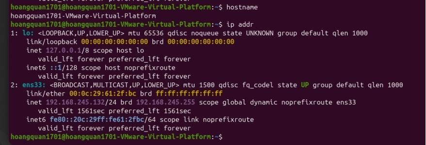
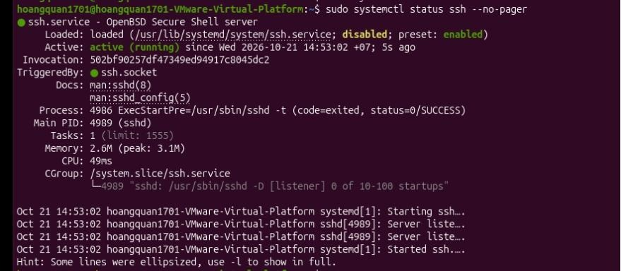
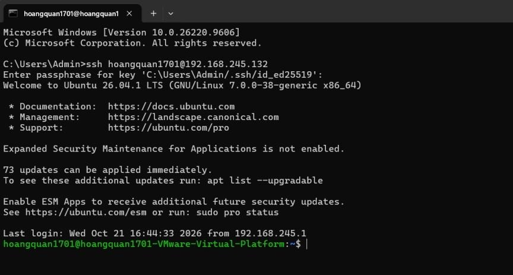
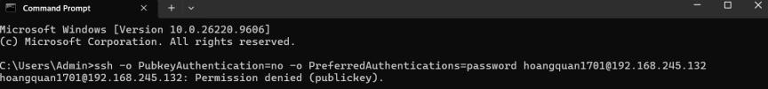
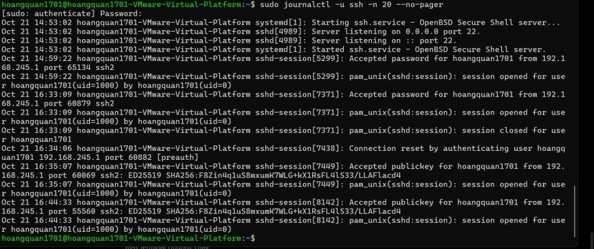

# Windows – Ubuntu Remote Access via SSH

A hands-on academic project demonstrating remote access from Windows 11 to an Ubuntu Linux virtual machine using SSH.

## 1. Project Overview

The purpose of this project is to set up and verify a secure remote connection between a Windows host and an Ubuntu virtual machine using OpenSSH.

The project covers SSH server configuration, SSH key-based authentication, network connectivity, and basic firewall configuration.

## 2. Environment

- **Host OS:** Windows 11
- **Virtualization:** VMware
- **Guest OS:** Ubuntu Linux
- **Remote Access Protocol:** SSH
- **SSH Server:** OpenSSH Server
- **Firewall:** UFW

## 3. Implementation

The following tasks were completed:

- Created and installed an Ubuntu virtual machine in VMware.
- Configured network connectivity between Windows and Ubuntu.
- Installed and enabled the OpenSSH Server service.
- Checked the SSH service status and verified that it was listening on port 22.
- Configured UFW to allow SSH connections.
- Generated an Ed25519 SSH key pair on Windows.
- Configured public key authentication for remote access.
- Verified successful SSH login using the private key.
- Tested and verified that password-based SSH authentication was disabled.

## 4. Verification

The configuration was verified through:

- Network connectivity testing using `ping`.
- SSH service status checking using `systemctl`.
- Port 22 listening status checking.
- Remote login testing from Windows.
- Authentication testing using SSH keys.
  
## 5. Project Screenshots

### Ubuntu Network Configuration

### SSH Service Status

### SSH Port 22

### SSH Key-Based Authentication

### Password Authentication Test

### SSH Authentication Logs

## 6. Skills Practiced

- Basic Linux administration
- SSH configuration and remote access
- SSH key-based authentication
- Basic firewall configuration
- Network connectivity troubleshooting
- Windows and Ubuntu interoperability

## 7. Learning Outcomes

Through this project, I gained practical experience in configuring Linux remote access, managing SSH services, setting up key-based authentication, and troubleshooting connectivity between different operating systems.

---

**Project Type:** Academic Practical Project  
**Author:** Hoang Binh Quan
